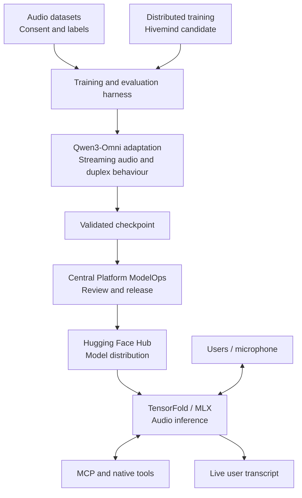

# Proposed architecture — Qwen3-Omni full-duplex speech-to-speech

## Objective

Build an open-source Qwen3-Omni-based voice model capable of continuous listening **while speaking**, natural low-latency speech, interruptions, group conversation and a live timestamped transcript of the user's speech. Retain the model's native speech output and structured tool calling.

## System diagram

## Design components

**Model adaptation — [#9](https://github.com/Community-AI-Lab/speech-to-speech/issues/9).** Investigate a causal streaming encoder or adapter over audio features; train listening and speaking concurrently with backchannels, corrections, interruptions, multi-speaker addressing and speech preservation. Test the actual encoder and model behaviour before choosing what to modify.

**Inference — [#10](https://github.com/Community-AI-Lab/speech-to-speech/issues/10).** TensorFold is the proposed real-time audio inference engine, with MLX or other implementations considered where appropriate. Maintain a microphone stream during playback, timestamped user transcription, speaker identity, playback reference for echo cancellation and structured tool/result events. Inference is separate from training.

**Training and evaluation harness — [#11](https://github.com/Community-AI-Lab/speech-to-speech/issues/11).** Use one reproducible harness for dataset preparation, checkpointing, training, evaluation and benchmarking. Start with a pilot of 30–50 annotated clips, evaluate the stock model, and compare checkpoints on identical held-out scenarios. Measure first-audio latency, interruption handling, transcription, tool-call correctness, speech quality, real-time factor and compute usage.

**Distributed training — [#12](https://github.com/Community-AI-Lab/speech-to-speech/issues/12).** Reuse the same training harness with distributed coordination for GPU workers. Evaluate [Hivemind](https://github.com/learning-at-home/hivemind) as a *candidate* for decentralized training and compare it with conventional multi-node methods before selecting a backend. Validate checkpoint synchronization, failures, throughput and correctness on a small multi-machine run.

**Data and permissions — [#4](https://github.com/Community-AI-Lab/speech-to-speech/issues/4).** Keep provenance, licenses, voice consent and rights checks for recordings and other training data.

**Model publishing — [Platform #7](https://github.com/Community-AI-Lab/platform/issues/7).** This model repository trains and evaluates the model. Central Platform ModelOps registers, approves and publishes versioned artifacts to the Hugging Face Hub, using a shared release manifest. The Hub distributes files; it is not assumed to provide live inference or customer billing.

## Milestones

1. Reproduce a spoken input → validated mock/native tool call → spoken result, with automated evaluation.
2. Evaluate and train low-latency streaming input, live user transcription, overlapping listening and speech, interruptions and group interactions.
3. Run the same training harness across distributed GPU workers and compare with a single-machine baseline.
4. Package and submit a validated release to central ModelOps for publishing on Hugging Face; serve a pinned release through an appropriate audio inference runtime.

## Research and datasets

- [Qwen3-Omni overview](https://qwen.ai/blog?id=qwen3-omni)
- [Interact-0 technical design](https://interact.inc/blog/interact-0/)
- [NVIDIA PersonaPlex](https://github.com/NVIDIA/personaplex)
- [otoSpeech full-duplex turn (104h)](https://huggingface.co/datasets/otoearth/otoSpeech-full-duplex-turn-104h)
- [otoSpeech full-duplex task-oriented v2](https://huggingface.co/datasets/otoearth/otoSpeech-full-duplex-task-oriented-v2)
- [Task-oriented demo](https://cc-task-oriented-preview.vercel.app/)

These are references, not automatic approval to reuse model weights or datasets. Check licenses, attribution, consent and redistribution permissions before use.
